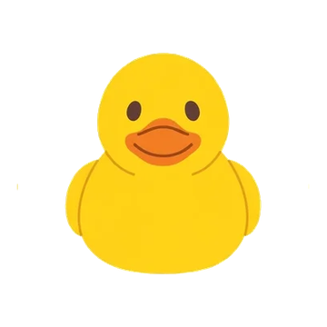

  
  

# Amro Abed Moosa

I build tools that take the boring work off your plate, and I like showing people how they work. Full-stack, AI, automation, iOS, ML, a bit of everything, not one lane.

---

### Currently building

**[Kareer](https://kareer.itsamro.me/)** — a browser extension that fills in job applications from a resume. Local-first, zero telemetry, no backend. Adapters for Ashby, Greenhouse, Lever, and Workday. 640+ tests, MIT open source.

### Also built

- **[Syllabus Sync](https://github.com/Amro212/Syllabus-Sync)** — iOS app that turns course syllabi into calendar events.
- **[Transformer Training Optimization](https://github.com/Amro212/transformer-training-benchmark)** — benchmarking four ways to train a GPT-style model on one GPU.
- **[CurlAI](https://github.com/Amro212/CurlAI)** — a webcam app that counts your bicep curls with a custom-trained model.
- **[LEGEND](https://legend.guru)** — a memecoin whose creator fees helped build a school in Nigeria.

---

yes, the duck is the mascot. it quacks.

  

