# Amro Abed Moosa

**Computer Engineer**

> I build tools that take the boring work off your plate, and I like showing people how they work.

🦆 yes, the duck is the mascot. it quacks.

📍 Milton, Ontario, Canada

**Right now:** building [Kareer](https://github.com/Amro212/kareer) in the open, and hunting for an Applications Engineering role in Canada. Demos, integrations, and talking to customers, not sitting in a corner coding all day.

---

## What I built

### [Kareer](https://kareer.itsamro.me/) — the one I'm proudest of

A browser extension that fills in job applications from a resume. Local-first, zero telemetry, no backend. Adapters for Ashby, Greenhouse, Lever, and Workday, plus a generic fallback.

**640+ tests · 4 ATS adapters · 0 telemetry · MIT open source**

[Site](https://kareer.itsamro.me/) · [Repo](https://github.com/Amro212/kareer)

---

### [Syllabus Sync](https://github.com/Amro212/Syllabus-Sync)

An iOS app that turns course syllabi into calendar events. SwiftUI + Supabase, with an in-app calendar and import tracking.

[Repo](https://github.com/Amro212/Syllabus-Sync)

---

### [Transformer Training Optimization](https://github.com/Amro212/transformer-training-benchmark)

Benchmarking four ways to train a GPT-style model on one GPU. AMP + checkpointing hit batch 64 vs 24 baseline, and 8,710 vs 2,434 tokens/s.

[Repo](https://github.com/Amro212/transformer-training-benchmark)

---

### [CurlAI](https://github.com/Amro212/CurlAI)

A webcam app that counts your bicep curls with a custom-trained model. OpenCV frames, a LinearSVC classifier, and a rep counter. Small, local, no cloud.

[Repo](https://github.com/Amro212/CurlAI)

---

### [LEGEND](https://legend.guru)

A memecoin on Solana. The creator fees helped fund the construction of a school in Nigeria. Peak market cap around $278k.

[Site](https://legend.guru)

---

## The stack

  
  
  
  
  
  
  
  
  
  
  
  
  
  
  
  
  
  
  
  
  

 

**Languages:** Python, TypeScript, JavaScript, Swift, SQL, C, C++

**What I reach for:** React, Node.js, SwiftUI, PyTorch, REST APIs, Cloudflare Workers, Docker, CI/CD, pytest

---

## Where I've worked

- **Sandbox Software Solutions** — Software Developer Intern, Sep–Dec 2025
- **County of Dufferin** — IT Technician, Apr–Sep 2025
- **University of Guelph** — Web Dev & IT Support Coordinator, Jun–Sep 2024
- **Outlier** — Coding Expert, Jan–Sep 2024
- **Camis** — QA Analyst, Jan–May 2024

Computer Engineering (Co-op), University of Guelph, 2021–2026.

---

## Say hi

- **Email:** [amromousa8@gmail.com](mailto:amromousa8@gmail.com)
- **LinkedIn:** [linkedin.com/in/amro-abedmoosa](https://linkedin.com/in/amro-abedmoosa)
- **Portfolio:** [itsamro.me](https://itsamro.me)

---

<picture>
  <source media="(prefers-color-scheme: dark)" srcset="https://raw.githubusercontent.com/Amro212/Amro212/output/pacman-contribution-graph-dark.svg">
  <source media="(prefers-color-scheme: light)" srcset="https://raw.githubusercontent.com/Amro212/Amro212/output/pacman-contribution-graph.svg">
  
</picture>

  

